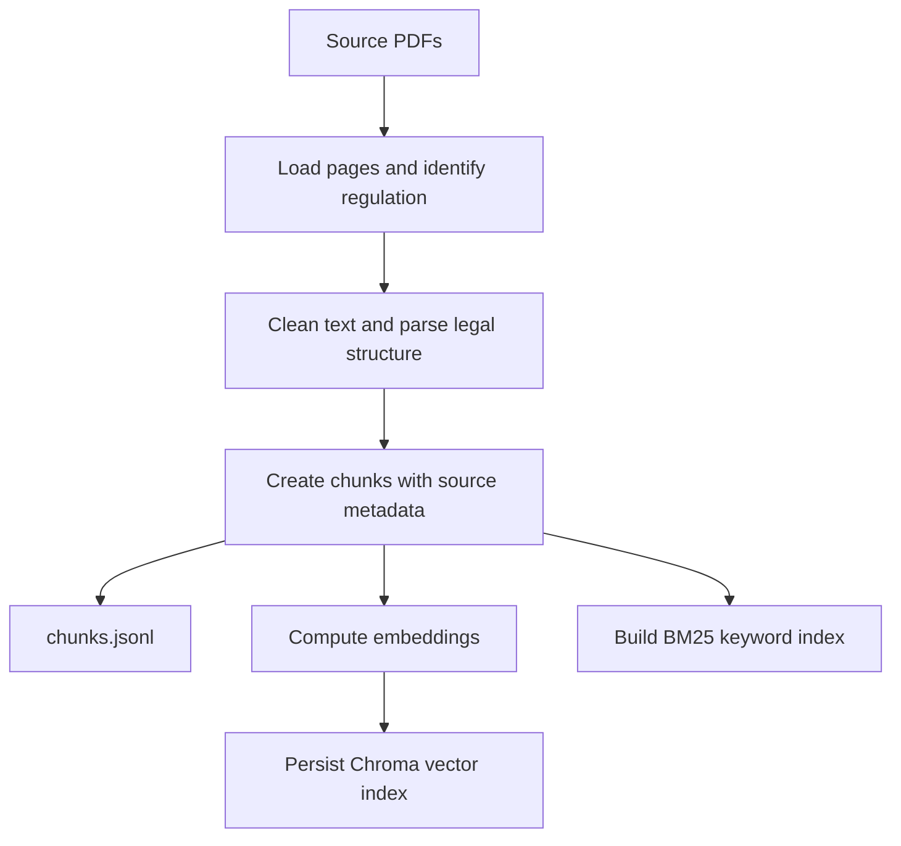
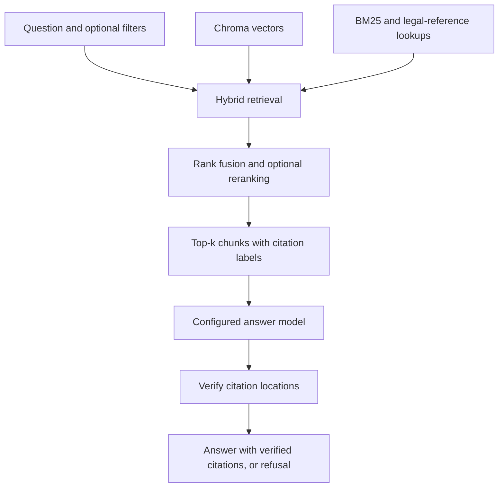
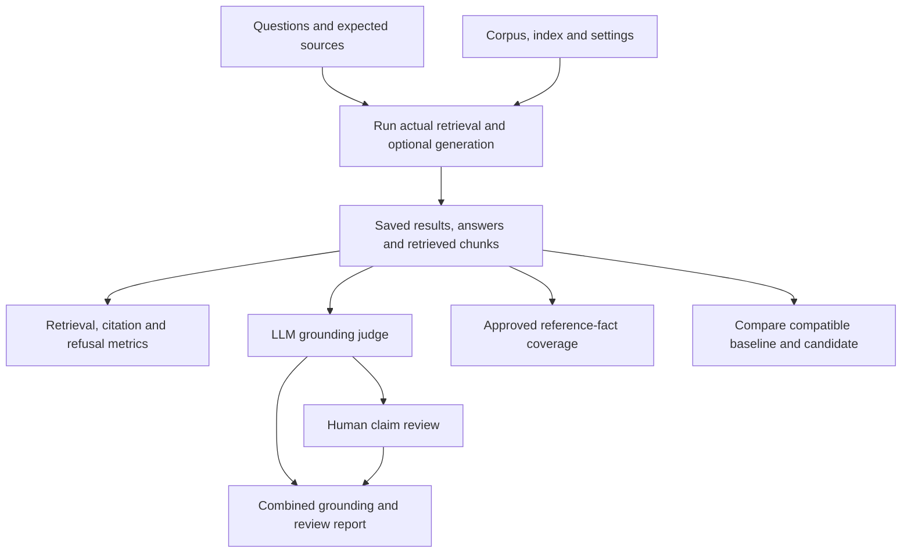

# EU Law RAG: application and evaluation framework

A Python project that answers questions about the GDPR and the EU AI Act using retrieved
PDF passages, then evaluates how well the system retrieves evidence and produces supported answers.

The project has two connected parts:

1. **The RAG application** turns source PDFs into searchable chunks and generates answers with citations.
2. **The evaluation framework** checks source quality, retrieval, grounding, reference coverage,
   refusal behaviour, robustness, security controls, performance and regressions.

The evaluation records weaknesses as findings. Expected sources and application behaviour are
not changed simply to make an evaluation pass.

> **Source scope:** the AI Act PDF is the European Parliament first-reading text of 13 March
> 2024, not the final Official Journal regulation. Findings apply to the supplied corpus.
> Generated answers are not legal advice. See [source details](data/raw/README.md).

## Contents

- [Project at a glance](#project-at-a-glance)
- [Application architecture](#application-architecture)
- [What happens at each application stage](#what-happens-at-each-application-stage)
- [Evaluation architecture](#evaluation-architecture)
- [What each evaluation layer checks](#what-each-evaluation-layer-checks)
- [Understanding the metrics](#understanding-the-metrics)
- [Implementation and file responsibilities](#implementation-and-file-responsibilities)
- [Application setup](#application-setup)
- [Running the evaluation](#running-the-evaluation)
- [Recorded results and their limits](#recorded-results-and-their-limits)
- [Project structure](#project-structure)
- [CI, remaining work and documentation](#ci-remaining-work-and-documentation)

## Project at a glance

| Item | Current implementation |
|---|---|
| Source documents | GDPR PDF and Parliament AI Act first-reading PDF |
| Recorded corpus | 1,154 chunks: 454 GDPR and 700 AI Act |
| Chunking | Legal structure, with size-based splitting of larger units |
| Embeddings used in the measured local runs | `BAAI/bge-small-en-v1.5`, 384 dimensions |
| Search | Dense vector search + BM25 + explicit legal-reference lookup |
| Search combination | Weighted reciprocal rank fusion; optional reranking |
| Measured retrieval configuration | Chroma, top-k 5, 20 candidates per base retriever, reranking disabled |
| Answer model | Configurable Ollama, OpenAI or Anthropic; recent reported answer runs used OpenAI `gpt-6-luna` |
| Interfaces | CLI, FastAPI and Streamlit |
| History | SQLite locally; optional Supabase authentication and storage |
| Evaluation dataset | 26 questions: 20 answerable and six out of scope |
| Judging | LLM grounding judge plus a separate reference-fact coverage pilot |
| Software CI | Ubuntu and Windows workflow, Python 3.13 |

These describe the implementation and recorded runs, not an enforced configuration for every deployment.

## Application architecture

There are two flows: building the index and answering a question.

### A. Build the index



### B. Answer a question



The model does not search the PDFs itself. It receives the question and the selected chunks.
Citation verification checks that cited locations can be matched to those chunks; semantic support
is assessed separately by the evaluation framework.

## What happens at each application stage

| Stage | Input | Implementation | Output |
|---|---|---|---|
| 1. Load | PDFs under `data/raw/` | PyMuPDF extracts text by page; signature detection identifies the regulation | Page text with source and regulation identity |
| 2. Clean | Extracted page text | Normalise layout artefacts while retaining page associations | Cleaned text for parsing |
| 3. Parse | Cleaned text and page locations | Identify ordered legal headings and units such as articles, recitals and annexes | Structured legal units |
| 4. Chunk | Legal units | Keep smaller units whole; split long articles by sequential paragraphs/definitions when possible; pack larger content by lines | `Chunk` records containing text, ID, legal locator and page range |
| 5. Index | Chunks | Embed text for vector search; build a separate BM25 index | Chroma records and persisted keyword-index data |
| 6. Retrieve | Question, top-k and optional filters | Search dense and keyword indexes; add rankings for named articles/recitals/annexes; combine ranks and optionally rerank | Ranked `ScoredChunk` objects |
| 7. Generate | Question and retrieved chunks | Build a sources-only prompt with exact citation labels; call the configured LLM | Raw model response |
| 8. Verify | Raw response and retrieved context | Resolve supported citation locations, canonicalise tags and remove unmatched recognised tags | `Answer` with citations/context, or standard refusal |
| 9. Record history | Answer and run metadata, when using `HistoryService` | Persist model label, chunk IDs, index fingerprint, user, filters and rating fields | Reviewable run history |

The direct CLI `ask` route uses `AskService`; it does not automatically save a history record.
The history service is a separate wrapper used by flows that need persistence.

### Example chunk and answer

A chunk carries enough metadata to trace retrieved evidence back to a source. This is an
abbreviated schema example; additional optional fields are omitted:

```json
{
  "chunk_id": "GDPR:art17:para1:seq0",
  "regulation": "GDPR",
  "article": "17",
  "paragraph": "1",
  "text": "<extracted paragraph text>",
  "page_start": 61,
  "page_end": 61,
  "source_file": "full.pdf"
}
```

For a question such as **“What does GDPR Article 17 say?”**, the response includes answer text,
citations such as `[GDPR Art. 17(1), p. 61]`, retrieved chunks and latency. `--show-chunks`
shows the retrieved headings; `--json` returns the structured `Answer`.

If no context was retrieved, the generator returns the standard refusal without calling the LLM.
It also returns that refusal when the processed response contains the refusal phrase or has no
surviving verified citations:

```text
Not covered by the provided documents
```

A surviving citation does not prove that every sentence is supported. That is why the project
also evaluates claim grounding.

## Evaluation architecture

Evaluation answers different questions at different layers: **Was the data extracted correctly?**
**Was the right evidence retrieved?** **Does the answer follow that evidence?**
**Does it cover the required facts?** **Does behaviour remain stable under attacks and changes?**



Robustness/security scripts exercise additional cases. Benchmark scripts repeat retrieval or
answer attempts and save timing/error observations. They complement the saved-answer evaluation.

## What each evaluation layer checks

| Layer | Input | How it works | Output and interpretation |
|---|---|---|---|
| Source/chunk validation | PDFs and `chunks.jsonl` | Validate chunk schema, unique IDs, text presence, source readability and page bounds | Issue report; zero structural issues does not establish complete or faithful extraction |
| Manual fidelity sampling | Selected chunks and original PDF pages | Compare legal locator, wording, conditions, exceptions and contamination | Recorded sample pass/fail with discrepancies |
| Retrieval quality | Questions with expected sources | Retrieve once, compare returned source locators with expected ones, save missing sources and context | Hit rate, recall and complete-source rate |
| Citation/reference match | Generated citations and expected sources | Check whether at least one citation matches an expected source | Existing `citation_accuracy` field; not semantic accuracy or all-citation precision |
| Refusal behaviour | Dataset type and application result | Compare recorded refusal flag with answerable/out-of-scope label | Correct refusals, false refusals and unexpected answers |
| LLM grounding judge | Saved answer and its retrieved chunks | Extract claims; classify each against supplied evidence | Supported, contradicted, insufficient evidence or uncertain; evidence IDs and reasons |
| Reference coverage pilot | Answer and approved required facts | Assess each fact and capture exact answer quotes | Covered, partially covered, missing, contradicted or uncertain |
| Human review/calibration | Flagged claims or sampled supported claims | Review original claim positions and evidence; retain reviewer decisions separately | Reviewed, pending or unresolved findings; no automatic replacement of judge verdicts |
| Regression | Baseline/candidate results and manifests | Validate compatibility, then check aggregate and per-question non-decline | Pass/fail with per-question declines; incompatible inputs are not scored |
| Robustness/security | User attacks or altered in-memory source contexts | Run full CLI or controlled generation; retain raw/final output and observations | Cases requiring semantic review; no marker alone is not a security guarantee |
| Performance/reliability | Repeated attempts with defined warm-up | Measure successful/failed attempts, distributions and observed stability | Latency statistics and errors; acceptance remains unmeasured without targets |

### Is this LLM-as-a-judge?

**Yes.** `LLMJudge` sends saved answers and retrieved evidence to a configured LLM using the
versioned `grounding-v1` rubric. It validates the response schema and referenced chunk IDs.
A valid schema means the assessment is well formed, not necessarily correct.

The initial baseline used the same configured model for answering and judging. Findings remain
advisory; independent calibration is still needed. The judge is a separate evaluation step,
not another live answer-generation stage for the end user.

### Grounding and completeness are different

An answer can correctly summarise an obligation from a retrieved paragraph and still omit a
required detail. The grounding judge may mark that claim supported, while reference coverage
marks the corresponding required fact partially covered. Both can be valid findings.

The current reference pilot contains **three overview facts for d01 only**. It does not measure
exhaustive Article 17 coverage or overall legal correctness.

## Understanding the metrics

Suppose a question expects four sources and retrieval finds three:

| Metric | Example result | Meaning |
|---|---|---|
| Retrieval hit@5 | True | At least one expected source was found in five retrieved chunks |
| Source recall@5 | 3/4 = 75% | Three of the four expected sources were found |
| Complete-source retrieval | False | Not all expected sources were found |

Expected-source matching is at regulation plus article, recital or annex level. It does not
require every relevant paragraph or prove that retrieved text fully answers the question.

| Report metric | Definition / boundary |
|---|---|
| Hit rate@k | Share of answerable questions with at least one expected-source hit |
| Mean source recall@k | Average of available per-question expected-source recalls |
| Complete-source rate@k | Share of answerable questions with no application error, recall 1 and no missing sources |
| Expected-source citation match | Share of measured answerable cases matching at least one expected source |
| False refusal rate | Share of measured answerable cases recorded as refused |
| Out-of-scope refusal accuracy | Share of measured out-of-scope cases recorded as refused |
| Claim support rate | Supported claims divided by all extracted assessed claims; provisional judge result |
| Strict reference coverage | Fully covered required facts divided by all assessed required facts; partial facts do not get half credit |
| p95 latency | Nearest-rank percentile; on nine samples it equals the maximum |

The current evaluation runner derives its refusal flag from the absence of citations, rather than
an independent semantic refusal classifier. Refusal wording and dataset-based refusal correctness
therefore need separate review. Retrieval-only runs show generation metrics as `n/a` because
generation was not measured.

Application errors must remain visible. A generation error preserves retrieved context and
retrieval timing; it must not be silently reclassified as a successful refusal. The basic
`latency_ms` evaluation field comes from generation; use benchmark outputs for combined
retrieval-plus-generation timing.

## Implementation and file responsibilities

Paths below are relative to `src/rag_eu_law/` unless shown otherwise.

| Files / classes | Responsibility |
|---|---|
| `app/config.py`: `Settings` | Load `RAG_` settings from environment/`.env`; validate required provider credentials |
| `app/container.py`: `Container` | Build and cache configured embedders, stores, retriever, LLM and services |
| `domain/models.py`, `domain/protocols.py` | Shared data contracts and swappable component interfaces |
| `ingestion/loader.py`, `cleaner.py`, `identify.py`, `parser.py`, `chunker.py`, `pipeline.py` | Convert PDFs into structured, traceable chunks |
| `indexing/embedder.py`, `vector_store.py`, `keyword_index.py`, `pipeline.py` | Build embeddings and persistent search stores |
| `retrieval/hybrid.py`, `references.py`, `fusion.py`, `reranker.py` | Dense/keyword/reference rankings, rank fusion and optional reranking |
| `generation/prompts.py`, `llm_clients.py`, `generator.py`, `citations.py` | Source-labelled prompts, provider calls, answer/refusal and citation checks |
| `evaluation/models.py`, `loader.py`, `runner.py`, `metrics.py`, `report.py` | Question/result schema, one retrieval per question, deterministic metrics and baseline report |
| `evaluation/judge.py`, `judge_models.py`, `judge_runner.py` | Grounding rubric, structured claim assessments and batch result records |
| `evaluation/judge_report.py` | Report grounding findings alongside claim-level human reviews |
| `evaluation/reference_loader.py`, `reference_judge.py`, `reference_metrics.py` | Validate approved reference facts and assess their answer coverage |
| `evaluation/provenance.py`, `index_fingerprint.py`, `regression.py` | Capture identity, fingerprint logical Chroma content and compare retrieval runs |
| `evaluation/performance_metrics.py` | Validate latency samples and calculate distribution summaries |
| `storage/sqlite_store.py`, `app/history.py` | Persist reviewable runs; close SQLite connections explicitly |

### Why logical index fingerprints?

Chroma's physical `chroma.sqlite3` bytes changed between observed executions even when the
logical collection fingerprint was unchanged. Version-2 provenance therefore records SQLite
byte differences diagnostically, while enforcing logical records/configuration/metadata and
non-SQLite search-index artifacts.

It also captures dataset/source hashes, chunks, keyword data, retrieval settings, application
Python files and selected environment/package versions. Results must match their manifest digest.
Changed strict identity fields cause an incompatible comparison, rather than a misleading pass.

Snapshots are not atomic against concurrent writers. Model weight artifacts are not pinned;
index-build lineage and script identity outside the application package are not fully enforced.
Equal fingerprints do not establish authenticity, deterministic ranking or answer correctness.

## Application setup

From the project root in Windows PowerShell:

```powershell
python -m venv .venv
.\.venv\Scripts\python.exe -m pip install -e ".[index,llm,api,ui,cloud]" pytest pytest-cov
Copy-Item .env.example .env
```

For an existing installation, keep your current `.env`. Select the provider and an available
model there. Ollama needs a running local server and the configured model installed; hosted
providers need their corresponding API key. Do not commit `.env`.

```powershell
.\.venv\Scripts\rag-eu-law.exe ingest
.\.venv\Scripts\rag-eu-law.exe ask "What does GDPR Article 17 say?" --show-chunks
.\.venv\Scripts\python.exe -m streamlit run src/rag_eu_law/app/ui.py
# Alternatively, start the HTTP API:
.\.venv\Scripts\python.exe -m uvicorn rag_eu_law.app.api:app
```

With uv, use `uv sync --all-extras` and `uv run` for the equivalent application commands.
Deployment instructions are in [DEPLOY.md](DEPLOY.md).

### Key configuration

| Setting | Purpose |
|---|---|
| `RAG_LLM_PROVIDER` | Select `ollama`, `openai` or `anthropic` |
| `RAG_OLLAMA_MODEL`, `RAG_OPENAI_MODEL`, `RAG_ANTHROPIC_MODEL` | Select the model for the chosen provider |
| Provider API-key setting | Required for the corresponding hosted provider; keep it local |
| `RAG_EMBEDDER`, `RAG_EMBEDDING_MODEL` | Select embedding implementation and model |
| `RAG_VECTOR_STORE` | Select vector backend |
| `RAG_TOP_K`, `RAG_CANDIDATES_PER_RETRIEVER` | Control returned context and candidate retrieval |
| `RAG_RERANK_ENABLED`, `RAG_RERANK_MODEL` | Enable/configure optional reranking |
| `RAG_RAW_DIR`, `RAG_PROCESSED_DIR` | Set source and generated-index directories |
| `RAG_RUN_STORE` | Choose local SQLite or optional Supabase history mode |

For a model-only change, re-ingestion is normally unnecessary. Changing the embedding model or
corpus requires rebuilding the index and establishing fresh compatible evaluation evidence.

## Running the evaluation

Use a new output directory for each execution. The [runbook](docs/evaluation/RUNBOOK.md)
contains full commands, prerequisites and exit-code explanations.

### 1. Run software tests and validate the corpus

```powershell
.\.venv\Scripts\python.exe -m pytest -q -rs --tb=short
.\.venv\Scripts\python.exe .\scripts\validate_corpus.py `
    --output .\eval\runs\corpus-example-001.json
```

Tests exercise implementation behaviour; corpus validation checks generated records and source
pages. Neither alone establishes end-to-end answer quality.

### 2. Measure retrieval and compare a candidate

```powershell
.\.venv\Scripts\python.exe .\scripts\run_retrieval_evaluation.py `
    --output-dir .\eval\runs\retrieval-example-001
.\.venv\Scripts\python.exe .\scripts\run_retrieval_evaluation.py `
    --output-dir .\eval\runs\retrieval-example-002
.\.venv\Scripts\python.exe .\scripts\check_manifested_regression.py `
    --baseline .\eval\runs\retrieval-example-001\results.json `
    --candidate .\eval\runs\retrieval-example-002\results.json `
    --output .\eval\runs\retrieval-example-comparison.json
```

No answer-model requests are made here. Existing chunks/indexes are required, and embedding
initialization can contact Hugging Face. The gate checks aggregate and per-question changes so
an improvement on one question cannot hide a decline on another.

### 3. Capture answers, then judge saved results

These steps use the configured model and may incur API charges:

```powershell
.\.venv\Scripts\rag-eu-law.exe eval --output-dir .\eval\runs\answers-example-001
.\.venv\Scripts\python.exe .\scripts\judge_saved_results.py `
    --input .\eval\runs\answers-example-001\results.json `
    --output-dir .\eval\runs\judge-example-001 --dry-run
```

Remove `--dry-run` to judge. The runner saves per-question checkpoints; the same command can
resume remaining work. Changed input/prompt/schema/model configuration requires a new directory.
`--limit 1` processes at most one pending result; inspect `Batch complete` before calling a batch finished.

### 4. Build the combined report

```powershell
.\.venv\Scripts\python.exe .\scripts\build_evaluation_report.py `
    --run-dir .\eval\runs\judge-example-001 `
    --output .\eval\runs\judge-example-001\combined-report-001.md
```

The builder reads saved application and judge results, plus optional `human-review-001.json`.
It checks input provenance and displays pending, reviewed and unresolved findings. It makes no
model requests and does not alter judge verdicts based on human decisions.

### 5. Execute robustness, security and performance pilots

| Command under `scripts/` | Default scope | Saved output |
|---|---|---|
| `run_robustness.py` | Four full CLI user-input cases with UTF-8 capture | Per-case responses and execution information |
| `run_generation_security.py` | Four controlled cases; three expected model calls | Supplied contexts, raw/final responses and marker observations |
| `benchmark_retrieval.py` | 26 warm-ups and 78 measured retrievals, sequential | Latency, errors and returned-ID stability |
| `benchmark_answers.py` | Nine attempts across d01/c03/x05, sequential | Retrieval, generation and combined pipeline timings |

Each supports `--output-dir` and `--dry-run`. Execution success is separate from semantic review
or performance acceptance. Reusable reference-assessment/report commands remain unfinished;
the first reference-coverage pilot was run through a terminal snippet.

### Where outputs go

| Artifact | Contents |
|---|---|
| `results.json` | Question results, source IDs, captured context, answer/citations, timings and errors |
| `report.md` | Deterministic retrieval/citation/refusal summary |
| `provenance.json` | Before/after retrieval identity, stability and results-file digest |
| Judge `manifest.json` and `checkpoints/` | Judge input/configuration identity and saved per-record progress |
| `judge-batch-001.json` | Aggregated grounding assessments and batch-completion flag |
| Optional `human-review-001.json` | Claim-level reviewer decisions and reasons |
| Combined Markdown report | Grounding findings with review status and provenance |
| Benchmark/security/robustness JSON | Attempt-level observations and run-specific metadata |

New `eval/runs/` and `eval/calibration/` evidence is kept locally and ignored by default.
Reference/robustness inputs are versioned. Historical reports already in `eval/` remain tracked.
See the [dataset and evidence policy](eval/README.md) before sharing generated artifacts.

## Recorded results and their limits

These are recorded local observations, not a claim of independent reproduction or production readiness.

| Area | Recorded observation | Interpretation |
|---|---|---|
| Software verification | 426 passed, ten skipped, no warnings reported; 97% coverage; exit code 0 | Windows CI-style run, 28 October 2026; skipped tests require model downloads |
| Retrieval | Hit@5 100%; complete-source@5 65%; mean source recall approximately 84% | Twenty answerable questions; finding one source does not mean finding all evidence |
| Grounding pilot | 96 supported, nine insufficient-evidence claims | 105 extracted claims across 26 assessments; judge findings remain provisional |
| Reference coverage | Two facts covered, one partially covered | Three d01 facts; not an overall correctness score |
| Warm retrieval performance | Median 55.9 ms, p95 91.8 ms; zero execution errors | 78 measured attempts, concurrency one |
| Answer pipeline performance | Median 3.21 s, maximum 5.34 s; zero errors/refusals | Nine attempts; excludes CLI/UI/history and harness serialization |
| Security controls | Four controlled cases met expectations in assistant-assisted review | One execution per case and one injected-source payload |

Earlier [local model](eval/local-qwen2.5-7b/) and [OpenAI](eval/luna/) reports describe different
runs. They must not be silently combined with the newer baseline. The newer raw evidence is
not committed, so a clean checkout needs new runs or separately supplied artifacts to regenerate
those reports.

## Project structure

| Path | Responsibility |
|---|---|
| `src/rag_eu_law/domain/` | Models, protocols, constants and exceptions |
| `src/rag_eu_law/ingestion/` | PDF loading, cleaning, parsing and chunking |
| `src/rag_eu_law/indexing/` | Embedding, vector storage and BM25 indexing |
| `src/rag_eu_law/retrieval/` | Hybrid retrieval, reference lookup, fusion and reranking |
| `src/rag_eu_law/generation/` | Prompts, model clients, citation verification and answers |
| `src/rag_eu_law/evaluation/` | Metrics, judges, references, provenance, fingerprints and regression |
| `src/rag_eu_law/storage/` | SQLite, Supabase and in-memory run history |
| `src/rag_eu_law/app/` | Settings, wiring, CLI, API, UI and authentication |
| `scripts/` | Repeatable evaluation, report and benchmark commands |
| `tests/` | Unit, contract and integration tests |
| `eval/` | Question sets, reference facts and historical reports |
| `docs/evaluation/` | Architecture, runbook and progress tracker |
| `.github/workflows/` | Ubuntu and Windows software-test workflow |
| `cloud/`, `docker/`, `supabase/` | Deployment entrypoints and database migration |

## CI, remaining work and documentation

The [GitHub workflow](.github/workflows/evaluation-tests.yml) checks dependency consistency,
Python syntax and software tests on Ubuntu and Windows, then uploads dependency, JUnit and
coverage evidence. It does not invoke paid evaluation benchmarks. Ten real-model tests remain
disabled by default. The latest user update reported GitHub checks in progress; consult
[Actions](https://github.com/sachindongare11/rag-eu-ai-act-gdpr/actions) for their current result.

Local pytest success does not establish GitHub success. The workflow installs open dependency
ranges rather than using the committed uv lockfile. Lint and strict type checks for the full
evaluation addition still need revalidation.

Remaining work includes broader independent references/calibration, repeated and end-to-end
adversarial tests, approved performance targets, load/cold-start/timeout/retry/cost measurement,
embedding artifact pinning and portable baseline evidence. A regulation named in a question can
scope the whole retrieval search, which needs careful evaluation for cross-regulation questions.
The source-only prompt's recital-status instruction can also produce claims that are not
established by the retrieved text; the grounding evaluation records that limitation.

| Document | Use it for |
|---|---|
| [Evaluation architecture](docs/evaluation/ARCHITECTURE.md) | Layer boundaries, evidence relationships and provenance policy |
| [Runbook](docs/evaluation/RUNBOOK.md) | Repeatable commands and operational prerequisites |
| [Progress tracker](docs/evaluation/RAG_EVALUATION_PROGRESS.md) | Phase status, completed scope and backlog |
| [Application design](docs/DESIGN.md) | Original design decisions and historical experiments |
| [Source documents](data/raw/README.md) | Corpus version, filenames and page descriptors |
| [Evaluation inputs/evidence](eval/README.md) | Dataset roles and artifact-sharing policy |
| [Deployment guide](DEPLOY.md) | Streamlit, Docker and optional Supabase setup |

This is a working evaluation baseline. Grounding, citation matching, reference coverage,
software coverage and security observations measure different properties; none alone proves
overall legal correctness or production readiness.
