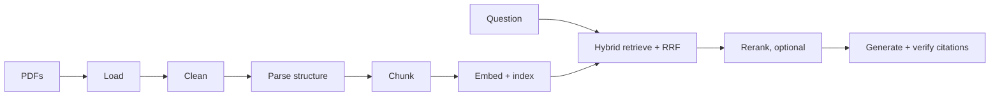

# EU law RAG: cited answers about the GDPR and the EU AI Act

Ask a question about the **GDPR** (Regulation (EU) 2016/679) or the **EU AI Act** and get an answer
that cites the exact source (`[GDPR Art. 17(1), p. 61]`). If the ingested texts do not support an
answer, the system says **"Not covered by the provided documents"** instead of guessing.

> Output is generated from the ingested texts and is **not legal advice**. Verify against the
> official sources.
>
> The AI Act file in `data/raw/` is the European Parliament's first-reading text of 13 March 2024
> (`P9_TA(2024)0138`), not the final Official Journal text of Regulation (EU) 2024/1689.
> Wording and recital numbers may differ.

## What it does

- **Reads the PDFs by legal structure**: recitals, chapters, articles, paragraphs and annexes become
  separate chunks with metadata (regulation, article, paragraph, page), not fixed-size windows.
- **Hybrid search**: dense embeddings + BM25 merged with reciprocal rank fusion, plus direct lookup
  when the question names "Article 22", "Recital 47" or "Annex III". Metadata filters supported.
- **Grounded answers**: the model sees only the retrieved passages. Every citation in the answer is
  checked against those passages; invented ones are removed, and an answer with no valid citation
  becomes a refusal.
- **Three interfaces**: command line, HTTP API (FastAPI) and a Streamlit web app with sign-in,
  source viewer, ratings and run history.
- **Swappable parts**: embedder, vector store and LLM (Ollama, OpenAI, Anthropic) are chosen by
  configuration; adding one means adding a class and registering it in one place.

## Quick start (local)

```bash
uv sync --all-extras              # install
cp .env.example .env              # defaults to a local Ollama model
uv run rag-eu-law ingest          # parse, chunk, embed and index the PDFs in data/raw/ (about 20-35 s)
uv run rag-eu-law ask "What does GDPR Article 17 say?"
```

For the default local model, run Ollama and `ollama pull qwen2.5:7b`. To use OpenAI instead, set
`RAG_LLM_PROVIDER=openai` and `RAG_OPENAI_API_KEY=...` in `.env` (model defaults to `gpt-6-luna`).

| Task | Command |
|---|---|
| Ask with filters | `uv run rag-eu-law ask "..." --regulation gdpr --article 22 --show-chunks` |
| Web app | `uv run streamlit run src/rag_eu_law/app/ui.py` |
| HTTP API | `uv run uvicorn rag_eu_law.app.api:app` (`POST /ask`, docs at `/docs`) |
| Evaluate | `uv run rag-eu-law eval` (or `--retrieval-only` without an LLM) |
| Tests and checks | `uv run pytest`, `uv run ruff check .`, `uv run mypy` |

## How it works



Stage-by-stage class names, design decisions and their rejected alternatives are in
[docs/DESIGN.md](docs/DESIGN.md).

## Evaluation

26 questions in [eval/questions.yaml](eval/questions.yaml): 7 direct lookups, 7 concept questions,
6 cross-regulation questions, 6 out-of-scope questions that must be refused.

| | local `qwen2.5:7b` | OpenAI `gpt-6-luna` |
|---|---|---|
| Retrieval hit rate@5 | 100% | 100% |
| Citation accuracy | 90% | 85% |
| Refusal accuracy (out-of-scope) | 100% | 100% |
| False refusals (answerable) | 5% | 5% |

The set is small and was written by the implementer, so treat it as a sanity check, not a benchmark.
Full reports: [eval/local-qwen2.5-7b/](eval/local-qwen2.5-7b) and [eval/luna/](eval/luna).

## Deploying

- **Streamlit Community Cloud (free):** entrypoint `cloud/streamlit_app.py`; steps in
  [DEPLOY.md](DEPLOY.md) (section A1).
- **Docker** (`Dockerfile`): ONNX embeddings, no PyTorch, index built into the image; see
  [DEPLOY.md](DEPLOY.md).
- **Shared history and login:** optional Supabase (SQL in [supabase/migrations/](supabase/migrations)).
  Without it, runs are saved to a local SQLite file and there is no login.

## Project layout

```
src/rag_eu_law/
  domain/      models, protocols (interfaces), exceptions, constants
  ingestion/   loader, cleaner, structure parser, chunker, pipeline
  indexing/    embedders, vector stores, BM25 index
  retrieval/   hybrid retriever, fusion, reference parsing, rerankers
  generation/  prompts, LLM clients, citation verification, answer generator
  evaluation/  question set loader, metrics, report
  storage/     run history stores (SQLite, Supabase, in-memory)
  app/         config, container (wiring), CLI, API, Streamlit UI, auth
cloud/         Streamlit Community Cloud entrypoint
tests/         unit, contract (shared by all implementations), integration
eval/          questions and reports
```

## Known limits

- Footnotes (mostly Official Journal references) are dropped, so they cannot be retrieved.
- Citations are checked for existence in the retrieved passages, not for whether the claim is
  faithful to them; a small local model can still over-read a source.
- A regulation named anywhere in a question filters the whole search to that law, which can hide
  the other law in cross-regulation questions (see eval question x02 in `docs/DESIGN.md`).
- The Anthropic client and the real cross-encoder reranker are only tested with fakes.

