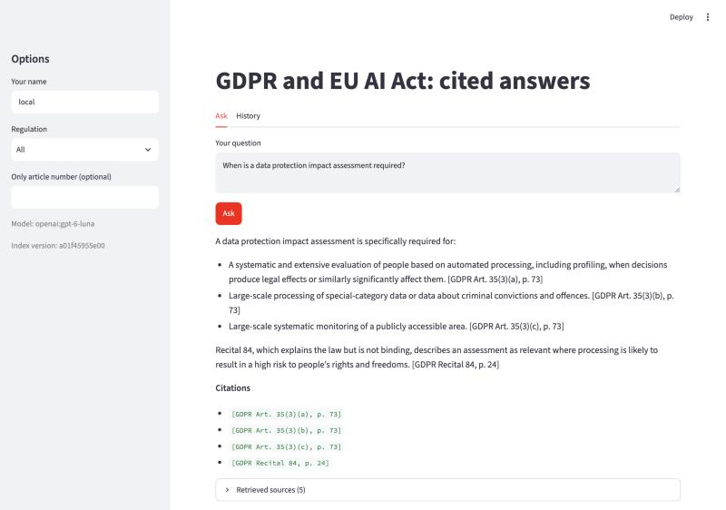
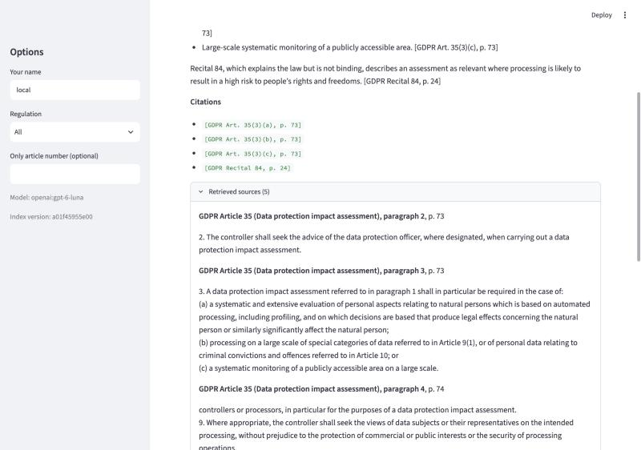

# EU law RAG and evaluation framework

A Python application for cited questions and answers over the GDPR and the EU AI Act,
with a separate evaluation framework for retrieval, answer grounding, reference coverage,
robustness, security controls, provenance, and performance.

The application verifies citation locations against retrieved chunks. This does not guarantee
that every statement is supported; the evaluation layer measures that separately.
Output is not legal advice.

**Corpus scope:** the AI Act PDF is the European Parliament first-reading text of 13 March
2024, not the final Official Journal text. Findings apply to this supplied corpus.
See [source documents](data/raw/README.md).

## Demo





## Application setup

From the project root in Windows PowerShell:

```powershell
python -m venv .venv
.\.venv\Scripts\python.exe -m pip install -e ".[index,llm,api,ui,cloud]" pytest pytest-cov
Copy-Item .env.example .env
```

For an existing installation, keep your current `.env`. Select the provider and an available
model there. Ollama needs a running local server and the configured model installed; hosted
providers need their corresponding API key. Do not commit `.env`.

```powershell
.\.venv\Scripts\rag-eu-law.exe ingest
.\.venv\Scripts\rag-eu-law.exe ask "What does GDPR Article 17 say?" --show-chunks
.\.venv\Scripts\python.exe -m streamlit run src/rag_eu_law/app/ui.py
# Alternatively, start the HTTP API:
.\.venv\Scripts\python.exe -m uvicorn rag_eu_law.app.api:app
```

With uv, use `uv sync --all-extras` and `uv run` for the equivalent application commands.
Deployment instructions are in [DEPLOY.md](DEPLOY.md).

## Evaluation quick start

Read the [runbook](docs/evaluation/RUNBOOK.md) for prerequisites and all commands.
Use a new run directory for each evaluation.

```powershell
.\.venv\Scripts\python.exe -m pytest -q -rs --tb=short
.\.venv\Scripts\python.exe .\scripts\validate_corpus.py --output .\eval\runs\corpus-review-001.json
.\.venv\Scripts\python.exe .\scripts\run_retrieval_evaluation.py --output-dir .\eval\runs\retrieval-review-001
```

The retrieval command captures provenance and does not call the answer model. It requires an
existing index; embedding initialization can contact Hugging Face. Full answer evaluation and
LLM judging use the configured model and may incur API charges.

| Evaluation layer | Input | Output |
|---|---|---|
| Corpus validation | PDFs and chunks | Schema, readability, source/page and duplicate-ID findings |
| Retrieval | Questions with expected sources and index | Hit rate, source recall, complete-source rate and saved chunks |
| Grounding judge | Saved answer and retrieved context | Claim verdicts, evidence IDs and reasons |
| Reference coverage pilot | Answer and three approved d01 facts | Covered, partial, missing, contradicted or uncertain facts |
| Human review | Flagged or sampled claims | Reviewer decisions displayed separately from judge verdicts |
| Regression | Two compatible manifested runs | Aggregate and per-question non-decline checks |
| Robustness/security | User attacks or controlled source contexts | Raw/final responses and observations requiring review |
| Performance | Repeated retrieval or answer attempts | Latency distributions, errors and stability observations |

## Recorded verification

Latest user-reported Windows CI-style run on 28 October 2026: **426 passed, 10 skipped,
97% statement coverage, no warnings reported, exit code 0**. The ten skipped tests require
model downloads. This is local evidence; GitHub runner results must be checked separately.

On the 26-question dataset (20 answerable, six out of scope), the captured retrieval baseline
reported hit rate@5 of 100%, complete-source rate@5 of 65%, and mean expected-source recall
of approximately 84%. These measure expected-source retrieval, not legal answer correctness.
The initial grounding batch marked 96 claims supported and nine insufficient evidence;
those model judgments remain provisional.

Earlier model-comparison reports in [eval/](eval/README.md) are historical runs. Their results
must not be substituted for the newer baseline. The newer raw run and calibration evidence
remains local and is not included in this branch.

## Project structure

| Path | Responsibility |
|---|---|
| `src/rag_eu_law/domain/` | Models, protocols, constants and exceptions |
| `src/rag_eu_law/ingestion/` | PDF loading, cleaning, parsing and chunking |
| `src/rag_eu_law/indexing/` | Embedding, vector storage and BM25 indexing |
| `src/rag_eu_law/retrieval/` | Hybrid retrieval, reference lookup, fusion and reranking |
| `src/rag_eu_law/generation/` | Prompts, model clients, citation verification and answers |
| `src/rag_eu_law/evaluation/` | Metrics, judges, references, provenance, fingerprints and regression |
| `src/rag_eu_law/storage/` | SQLite, Supabase and in-memory run history |
| `src/rag_eu_law/app/` | Settings, wiring, CLI, API, UI and authentication |
| `scripts/` | Repeatable evaluation, report and benchmark commands |
| `tests/` | Unit, contract and integration tests |
| `eval/` | Question sets, reference facts and historical reports |
| `docs/evaluation/` | Architecture, runbook and progress tracker |
| `.github/workflows/` | Ubuntu and Windows software-test workflow |
| `cloud/`, `docker/`, `supabase/` | Deployment entrypoints and database migration |

## Documentation and limits

- [Evaluation architecture](docs/evaluation/ARCHITECTURE.md)
- [Evaluation runbook](docs/evaluation/RUNBOOK.md)
- [Progress and remaining work](docs/evaluation/RAG_EVALUATION_PROGRESS.md)
- [Application design and historical decisions](docs/DESIGN.md)

The dataset and review samples are small. Assistant-assisted review is not independent human
validation. Reference coverage is a one-question, three-fact pilot, not exhaustive correctness.
Security checks cover a few controlled cases and one injected-source payload. Performance
measurements are sequential samples with no approved acceptance targets. Full load, cost,
timeout/retry and broader independent calibration work remains.
